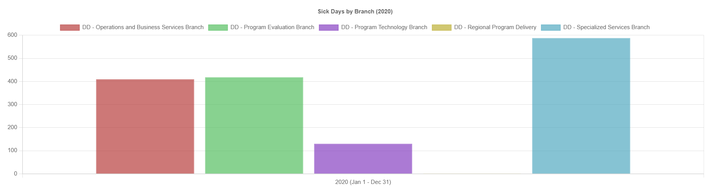
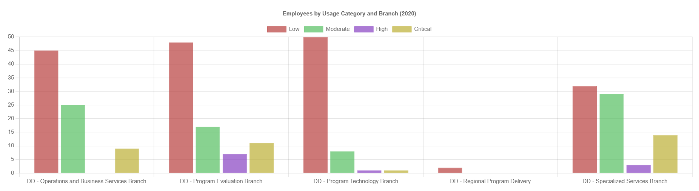

# HR Sick Time Usage Analysis (Excel Case Study)

An Excel analysis of employee sick-time records for a division made up of four corporate branches and one regional program office. The goal was to help a senior leader understand how sick time is used across the division, and what that means for wellness programs and workforce planning.

## Business problem
A senior leader wanted to understand sick-time usage within their division to guide wellness programs, workload planning and absence management. The analysis answers three questions:
1. How many sick days does each branch take, and how does this change across years?
2. How are employees distributed across sick-time usage levels, and where is high usage concentrated?
3. What should leadership know, and what actions should they take?

## Data
- ~1,960 employee records, each showing an employee's year-to-date sick days, branch, employment class and position.
- Records cover 2019–2021, but coverage is uneven (see Data limitations).
- Employee and manager names were anonymized in the source data.

## Approach
**1. Data review and cleaning**
- Checked which years and branches were represented before comparing anything.
- Found that 2019 contained a single record and 2021 covered only the Regional Program Delivery branch.
- Limited branch comparisons to 2020, the only year with data for all corporate branches, to avoid misleading conclusions.

**2. Usage categories**
Created a formula-based "Sick time usage" column to group employees into readable categories:

| Category | Sick days in the year |
|---|---|
| Low | 3 or fewer |
| Moderate | More than 3, up to 7 |
| High | More than 7, up to 10 |
| Critical | More than 10 |

## Visualizations

### Sick days by branch (2020)

*Total sick days by branch in 2020, the only year with data for all corporate branches.*

### Employees by usage category and branch (2020)

*Number of employees in each sick-time usage category (Low, Moderate, High, Critical) by branch.*

## Key findings
- **Most employees use little sick time.** About 85% of employees in 2020 fell into the Low or Moderate categories.
- **Sick time varies significantly by branch.** In 2020, Specialized Services had the most sick days (588) and Program Technology the fewest (130).
- **Critical usage is concentrated in a few branches.** Specialized Services (about 18% of employees) and Program Evaluation (about 13%) had the highest share in the Critical category, compared with under 2% in Program Technology.
- **Regional Program Delivery shows far higher total sick days**, but only in 2021, so it can't be compared directly with the other branches.

## Data limitations
- 2019 contained only a single record.
- 2021 includes data only from the Regional Program Delivery branch.
- Both years were excluded from comparisons, so no year-over-year trend could be measured.
- Totals reflect branch size as well as usage, so larger branches naturally show more sick days.

## Recommendations
- Provide targeted wellness or workload support for employees in high-usage groups.
- Monitor sick-time trends quarterly to detect early spikes.
- Standardize sick-time reporting across branches and years so future comparisons are reliable.

## What I'd do next
- Compare branches using average sick days per employee rather than totals, to account for different branch sizes.
- Separate long-term absences from short-term sick time, since they need different management approaches.

## Tools
Microsoft Excel: pivot tables, IF formulas, SUMIFS/COUNTIFS, charts
